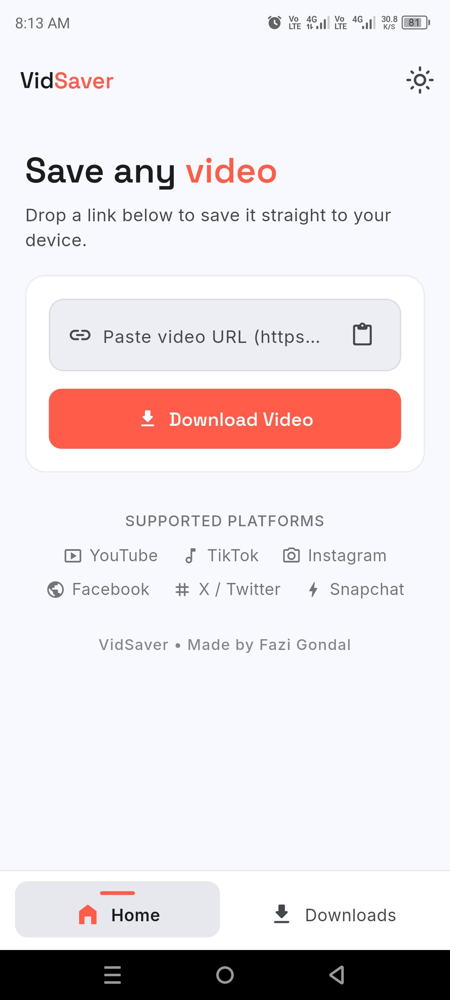
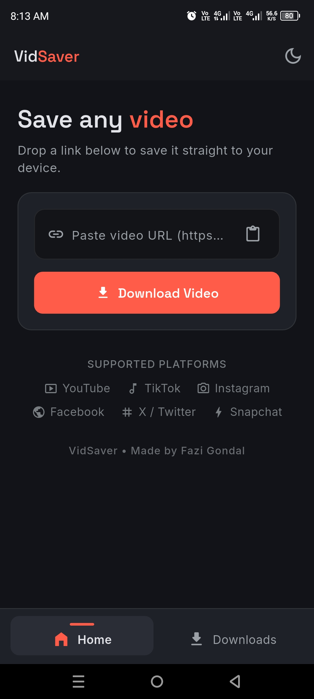
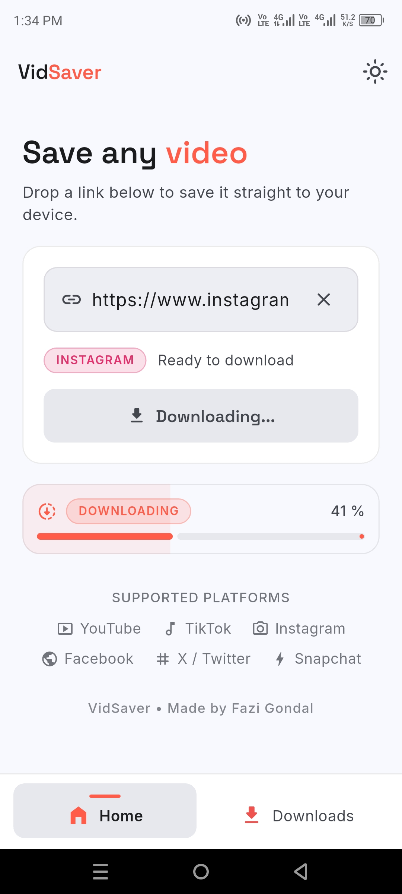
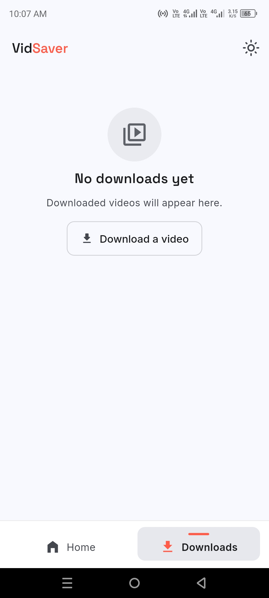
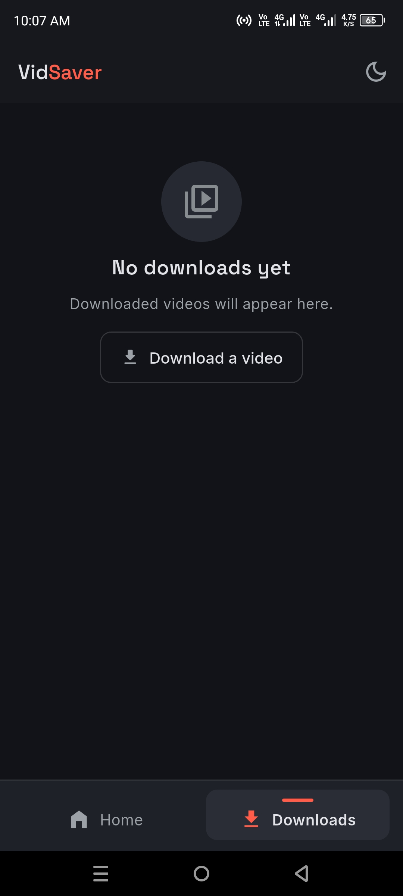
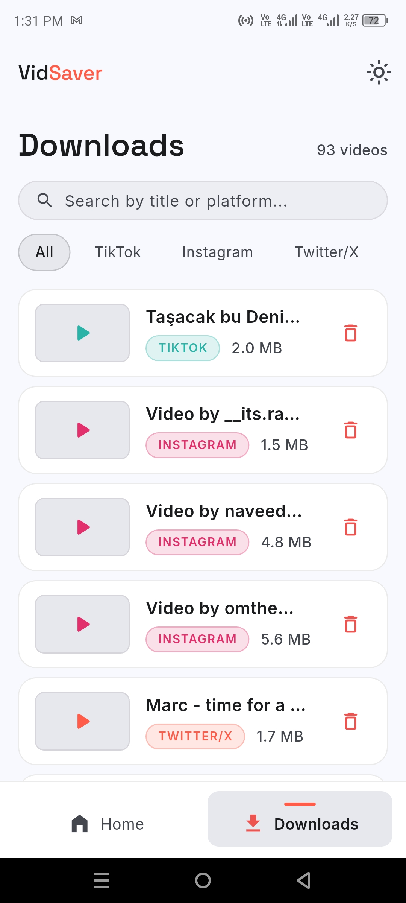
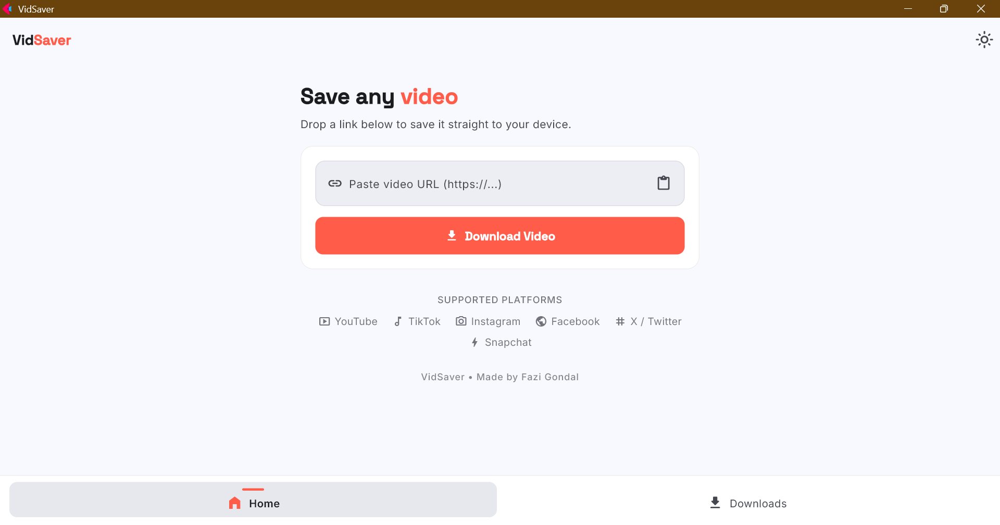
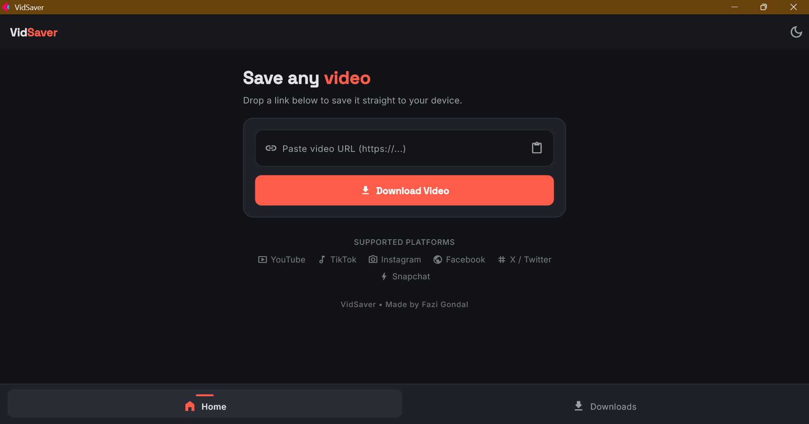
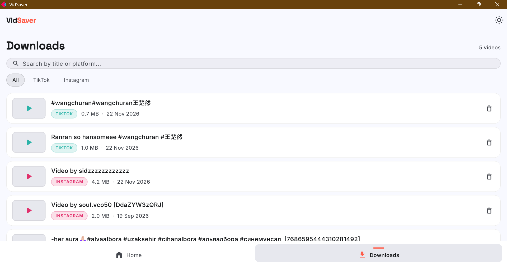

# Vidsaver

Vidsaver is a cross-platform video downloader built with **Python 3.14** and **Flet 1.1.2**. Powered by `yt-dlp`, it provides a fast, responsive mobile and desktop UI with the **Nocturnal Studio** design system for pasting links, tracking live download progress, managing your video library, and playing saved videos.

**Download TikTok and Instagram Reels without watermark in Full HD, plus YouTube, Facebook, X/Twitter, Snapchat, Reddit, Pinterest, Threads, Vimeo, Dailymotion, Twitch, LinkedIn, and Bilibili.**

## Features

- **Multi-Platform Downloads**: Supports TikTok, Instagram, YouTube, Facebook (`fb.watch`), X/Twitter (`t.co`), Snapchat, Reddit (`v.redd.it`), Pinterest (`pin.it`), Threads, Vimeo, Dailymotion, Twitch, LinkedIn, Bilibili, and other `yt-dlp` extractors.
- **Nocturnal Studio UI & UX**:
  - Custom `Space Grotesk` and `Inter` typography with tonal surface layering and `1px` subtle borders.
  - System light/dark theme support with a declarative moon/sun theme toggle in the top `AppBar`.
  - `BottomAppBar` navigation (`Home` & `Downloads`) with hover states and active indicator pill that stays beneath the soft keyboard while typing.
  - Native `View` stack navigation (`page.render_views`, `on_view_pop`, and `can_pop`/`on_confirm_pop`) so the Android Back button closes the video player to `Downloads` and returns from `Downloads` to `Home` instead of exiting the app.
  - Sunken borderless URL input with clipboard auto-paste on resume/focus, paste/clear actions, and automatic platform detection pill.
  - Compact live progress card with left-to-right progress gradient fill, status pill (`PREPARING`, `DOWNLOADING`, `SAVED`, `ERROR`), and floating completion `SnackBar`.
- **Smart Format Selection**: Automatically detects `ffmpeg` (`bv*+ba` on desktop) and falls back to pre-muxed `b[ext=mp4]/b` on mobile so Instagram, Facebook, and social downloads work without `ffmpeg`.
- **Android MediaStore Integration**: Publishes finished downloads through `flet-media-scanner` to `Movies/Vidsaver`, making videos appear in the Gallery without broad storage permissions.
- **Instant Downloads Library & Built-in Player**:
  - Cached library view stays mounted for instant tab switching and zero-reload return from video playback, with one-time background MediaStore sync.
  - Search by title or platform, filter by platform pills, view file size, and delete with confirmation.
  - Built-in full-screen video player powered by `flet-video` with playback error fallback.
- **Automated Testing & CI**:
  - Offline `pytest` unit test suite and `ruff` linting run automatically on every push and pull request to `main` via `.github/workflows/ci.yml`.
- **Automated Releases**:
  - Android APK release builds target `arm64-v8a`.
  - GitHub Releases attach:

    ```text
    Vidsaver-vX.Y.Z-Windows.zip              (portable — extract and run)
    Vidsaver-vX.Y.Z-Windows-setup.exe        (Inno Setup installer — installs to C:\Program Files\Vidsaver)
    Vidsaver-vX.Y.Z-Android-arm64-v8a.apk   (raw APK, direct sideload)
    Vidsaver-vX.Y.Z-Android-arm64-v8a.zip   (compressed APK, extract then install)
    ```

### Mobile Demo

| Light Mode | Dark Mode | Download |
| :---: | :---: | :---: |
|  |  |  |
| Light Mode | Dark Mode | List |
|  |  |  |

### Windows Demo

| Light Mode | Dark Mode | List |
| :---: | :---: | :---: |
|  |  |  |

## Tech Stack

- **Language**: Python 3.14+
- **UI Framework**: Flet 1.1.2 (declarative `@ft.component` architecture)
- **Video Player**: `flet-video` 1.1.2
- **Android MediaStore**: [`flet-media-scanner`](https://pypi.org/project/flet-media-scanner/) 1.0.3 (local workspace + PyPI extension)
- **Download Engine**: `yt-dlp`, `requests`, `certifi`
- **Package Manager**: `uv`

## Project Structure

```text
.
|-- .github/
|   |-- ISSUE_TEMPLATE/
|   |   |-- bug_report.md
|   |   `-- feature_request.md
|   `-- workflows/
|       |-- all-builds.yml                        (Windows + Android release CI/CD on v* tags)
|       |-- ci.yml                                (pytest, ruff, and py_compile on push/PR)
|       `-- generate-android-keystore.yml
|-- packages/
|   |-- flet-media-scanner/                   (custom Flet extension — published to PyPI)
|   `-- windows/
|       `-- installer.iss                     (Inno Setup script for Windows EXE installer)
|-- src/
|   |-- assets/
|   |   |-- fonts/                            (Inter & Space Grotesk TTF fonts)
|   |   |-- icon.png
|   |   `-- splash_android.png
|   |-- cookies.txt                           (optional yt-dlp cookies)
|   |-- downloader.py                         (platform detection & yt-dlp runner)
|   |-- home.py                               (HomeView URL input & progress card)
|   |-- library.py                            (Downloads library, search, platform filters)
|   |-- main.py                               (app entry point, View stack, BottomNavBar)
|   |-- player.py                             (built-in flet-video player)
|   |-- storage.py                            (storage paths, URL checks & MediaStore helpers)
|   `-- theme.py                              (Nocturnal Studio palettes, typography & helpers)
|-- tests/
|   |-- test_downloader.py                    (offline downloader unit tests)
|   |-- test_storage.py                       (storage & URL validation tests)
|   `-- test_theme.py                         (theme & UI helper tests)
|-- CHANGELOG.md
|-- CONTRIBUTING.md
|-- LICENSE
|-- pyproject.toml
`-- README.md
```

## Run Locally

Install dependencies and run the desktop app:

```bash
uv sync
uv run flet run
```

Run on Android device preview:

```bash
uv run flet run --android
```

Run as a web app:

```bash
uv run flet run --web
```

## Testing & Linting

Run the offline unit test suite and linter locally:

```bash
uv run pytest
uv run ruff check src tests
```

GitHub Actions automatically runs `py_compile`, `ruff`, and `pytest` on every push and pull request to `main` via `.github/workflows/ci.yml`.

## Android Permissions

The normal Android 13+ download flow does not request storage or media permissions. Vidsaver downloads into app-private staging storage, then publishes the finished video through Android MediaStore.

```toml
[tool.flet.android.permission]
"android.permission.INTERNET" = true
```

## Build Locally

Android `arm64-v8a` APK:

```bash
uv run flet build apk --split-per-abi --arch arm64-v8a --source-packages packages/flet-media-scanner --yes --verbose
```

Windows:

```bash
uv run flet build windows --source-packages packages/flet-media-scanner --yes --verbose
```

Build the Windows installer locally (requires [Inno Setup](https://jrsoftware.org/isinfo.php)):

```bash
ISCC.exe /DAppExe=vidsaver.exe /DAppVersion=1.6.0 /DAppArch=x64 packages\windows\installer.iss
```

## GitHub Release Workflow

The main release workflow is:

```text
.github/workflows/all-builds.yml
```

It runs when a version tag is pushed:

```bash
git tag v1.6.0
git push origin v1.6.0
```

To delete a tag locally and remotely (if you need to recreate/re-tag):

```bash
git tag -d v1.6.0
git push origin :refs/tags/v1.6.0
```

Normal pushes to `main` do not trigger the release build.

| Target | Runner | Output |
| --- | --- | --- |
| Windows | `windows-latest` | Portable `.zip` + Inno Setup `.exe` installer |
| Android | `ubuntu-latest` | Signed `arm64-v8a` `.apk` + `.zip` |

### Windows Installer (CI)

After `flet build windows`, the workflow runs `ISCC.exe` with `packages/windows/installer.iss`:

- Detects the `.exe` Flet produced automatically
- Passes version from the Git tag via `/DAppVersion`
- Output: `Vidsaver-windows-x64-setup.exe` in `build/`
- Installs to `C:\Program Files\Vidsaver` (64-bit)
- Creates Start Menu and optional Desktop shortcuts

The release job refuses to publish an Android APK unless the filename contains `arm64-v8a`, preventing accidental upload of a mislabeled `armeabi-v7a` APK.

## Android Signing

Stable Android signing is required so users can install new APK versions over older ones without uninstalling.

The release workflow expects these GitHub Actions secrets:

```text
ANDROID_KEYSTORE_BASE64
ANDROID_KEYSTORE_PASSWORD
ANDROID_KEY_PASSWORD
ANDROID_KEY_ALIAS
```

If these secrets are missing, Android release builds fail intentionally instead of publishing a debug-signed APK.

### Generate Android Keystore In GitHub

If you do not have Java or Android Studio locally, run `.github/workflows/generate-android-keystore.yml` from GitHub Actions, download the `android-keystore-github-secrets` artifact, copy the four values into repository secrets, and delete the artifact.

## Download Behavior

When a link is submitted:

1. The app displays a tonal status card with an active progress bar immediately (first-screen startup is non-blocking, with `yt-dlp` and `requests` pre-warmed in a background thread after first paint).
2. `yt-dlp` runs **cookie-free** by default with `js_runtimes={}` and `web_embedded` YouTube client fallback in a background thread so the UI stays responsive.
3. Short share URLs (`vm.tiktok.com`, `vt.tiktok.com`, `fb.watch`, `t.co/`, `t.snapchat.com`, etc.) are resolved automatically while full URLs skip redundant redirects.
4. Download progress updates the progress bar and gradient fill in real time.
5. On Android, the finished file is published to MediaStore under `Movies/Vidsaver`.
6. A floating `SnackBar` confirms completion with a **View** shortcut to Downloads.

Files are saved with the video's title as the filename — no platform IDs appended.

## Troubleshooting

- **`ModuleNotFoundError: certifi`**: Ensure `certifi`, `charset-normalizer`, `idna`, and `urllib3` are listed in `pyproject.toml` under `[tool.flet.android].dependencies`.
- **New version will not install over old version**: Caused by a different signing key or previous wrong ABI install. Uninstall the older build once and install the signed `arm64-v8a` APK.
- **Video does not appear in Gallery**: Vidsaver saves via MediaStore to `Movies/Vidsaver`; some Gallery apps take a few seconds to refresh.

## Documentation & Links

- [Changelog](CHANGELOG.md)
- [Contributing Guide](CONTRIBUTING.md)
- [License (MIT)](LICENSE)
- [Flet Documentation](https://flet.dev/docs/)
- [yt-dlp](https://github.com/yt-dlp/yt-dlp)
- [flet-media-scanner on PyPI](https://pypi.org/project/flet-media-scanner/)

<p align="center">
  Crafted with care by <strong>Fazi Gondal</strong>
</p>
